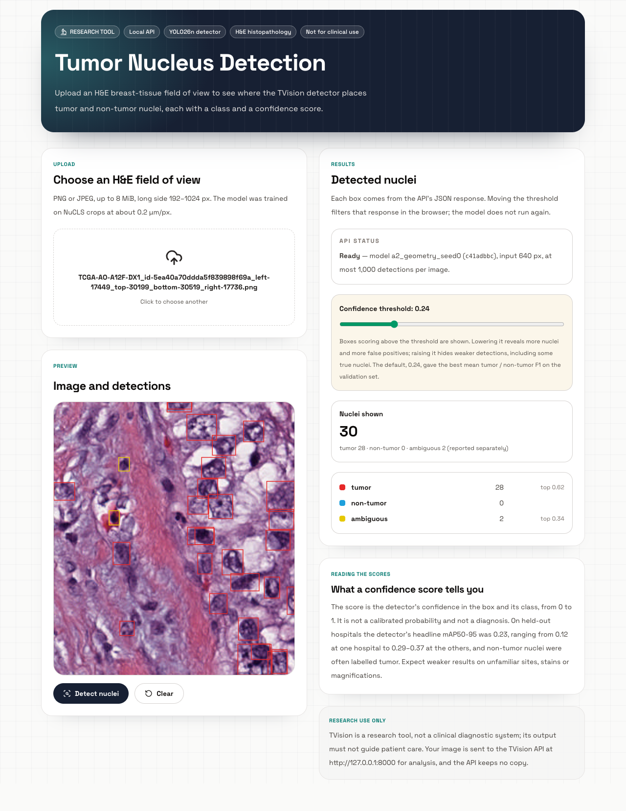

# TVision — Tumor Nucleus Detection

TVision detects and classifies tumor and non-tumor nuclei in H&E breast histopathology images. The pipeline runs from the public NuCLS dataset through a fine-tuned YOLO26 detector to a FastAPI service and a Nuxt web UI. Every stage is gated by automated checks, and the held-out test set was used exactly once.

> **Research use only.** TVision is not a medical device or a clinical diagnostic tool. Its output must not be used for diagnosis or to guide patient care.



*Detections on a NuCLS validation field of view (red: tumor, blue: non-tumor, yellow: ambiguous).*

## Highlights
- **Leakage-safe evaluation:** train, validation and test are separated by hospital, using NuCLS's official test fold. No slide, patient or hospital crosses splits.
- **Independently verified data:** every YOLO label is recomputed from the raw annotations by separate code before training is allowed, and the processed data is fingerprinted.
- **Validation-only model selection:** single-factor experiments against a hash-protected baseline, a selection rule fixed before any run, and repeats across 3 seeds.
- **One-shot test evaluation:** operating thresholds are fixed on validation first, and an append-only ledger records every test pass.
- **One typed detection contract** shared by the CLI, the API and the UI. The UI's TypeScript types are generated from the API schema.
- **330 Python tests and 11 frontend tests.** The suite also runs without the dataset or weights, as in CI.

## Results on held-out test hospitals

Four hospitals, 263 fields of view. The baseline and the validation-selected final model were each evaluated once. "Headline" is the unweighted mean of tumor and non-tumor; ambiguous nuclei are reported separately.

| Metric | Baseline | Final |
|---|---|---|
| Headline mAP50 | 0.476 | 0.489 |
| Headline mAP75 | 0.119 | 0.188 |
| Headline mAP50-95 | 0.199 | **0.232** |
| Tumor mAP50-95 | 0.203 | 0.192 |
| Non-tumor mAP50-95 | 0.194 | 0.273 |
| Tumor recall / F1 at the validation-chosen threshold | 0.616 / 0.484 | 0.681 / 0.504 |

- A paired, slide-level bootstrap puts the headline mAP50-95 gain at +0.034, 95% CI [+0.020, +0.054]. That covers sampling within these four hospitals, not generalization to new ones.
- The gain comes mainly from non-tumor nuclei and tighter boxes; tumor AP did not improve.
- One test hospital reaches only 0.12 headline mAP50-95, against 0.29–0.37 at the others. The most common error is calling a non-tumor nucleus tumor.

See [docs/ARCHITECTURE.md](docs/ARCHITECTURE.md) for the pipeline, the methods and how each stage is checked.

## Quickstart

**Requirements:**
- macOS on Apple silicon (the default device is `mps`; `--device cpu` or `--device cuda` works elsewhere);
- Python 3.11–3.12 with [uv](https://docs.astral.sh/uv/);
- Node 24 LTS.

```bash
git clone <this repository> && cd TVision
uv sync
```

**Model weights:** download `best.pt` from this repository's [Releases](../../releases) page and place it at `runs/step5a/a2_geometry/seed0/weights/best.pt`. It was fine-tuned from Ultralytics' `yolo26n.pt`. The detector refuses any file whose SHA-256 differs from the one pinned in `configs/inference.yaml`:

```
c41adbbcc990a3f711d7096924396f1ee87ec10fb1dfcdd4bb9714544002c44f
```

**Run the API and the web UI** in two terminals:

```bash
uv run python -m tvision serve            # API on http://127.0.0.1:8000 (add --device cpu off Apple silicon)
```

```bash
cd web && npm ci && npm run dev           # UI on http://localhost:3000
```

Open **http://localhost:3000**, choose an H&E field of view (PNG or JPEG, long side 192–1024 px, ideally about 0.2 µm/px) and press **Detect nuclei**. The confidence slider starts at 0.24, the threshold chosen on validation.

## Using the detector

### Command line and Python

```bash
uv run python -m tvision predict path/to/fov.png                    # DetectionResult JSON on stdout
uv run python -m tvision predict a.png b.png --out results/ --annotate   # <stem>.json and an annotated <stem>.png
# options: --conf C (at least 0.01), --device {mps,cuda,cpu}; existing files are never overwritten
```

```python
from tvision.config import Classes, Inference
from tvision.inference import Predictor

predictor = Predictor(Inference.load(), Classes.load())
result = predictor.predict("fov.png")    # also takes encoded bytes or a BGR uint8 array
print(result.model_dump_json(indent=2))
```

A `DetectionResult` (`src/tvision/contract.py`) holds:
- the image size and resize scale;
- the model info, including the checkpoint SHA-256;
- the threshold used;
- detections sorted by confidence, each with `class_id`, `class_name`, `confidence` and a pixel box `x1, y1, x2, y2`;
- per-class `counts` for `tumor`, `non_tumor` and `ambiguous`.

The deployed settings are a threshold of 0.24, imgsz 640, `max_det` 1000 and NMS IoU 0.7. At that threshold, headline precision / recall / F1 on validation is 0.605 / 0.574 / 0.589.

### HTTP API

`python -m tvision serve` loads the detector once and refuses to start if the checkpoint, its classes or the device don't match `configs/inference.yaml`. Server settings are in `configs/api.yaml`.

| Endpoint | Returns |
|---|---|
| `GET /health` | `{"status": "ok"}` |
| `GET /model` | Model info and input limits (long side 192–1024 px, `conf` ≥ 0.01, 8 MiB, PNG/JPEG) |
| `POST /detect` | `DetectionResult` for a multipart `file` and an optional form field `conf` |

```bash
curl -F "file=@fov.png;type=image/png" -F conf=0.3 http://127.0.0.1:8000/detect
```

- **Errors:** 411 (no Content-Length), 413 (too large), 415 (not PNG/JPEG, or content that doesn't match the declared type), 422 (unreadable image, long side out of range, `conf` out of range), 500 (inference failed). Each returns a JSON `detail`.
- **Capped responses:** a response holds at most `max_det` = 1000 detections. A response with exactly 1000 may have dropped weaker ones.
- **Scope:** the API is for local use. It has no authentication, binds to `127.0.0.1`, and allows the CORS origin `http://localhost:3000` only.

### Web UI

The Nuxt page in `web/` is a client of the API; it contains no model code.
- It sends one request per image at confidence 0.01, and the slider filters that response in the browser.
- If a response reached the 1,000-detection cap, the page says which weaker detections were cut off.
- Open it at `localhost:3000`, not `127.0.0.1:3000`, because of the API's CORS setting.
- To point it at another API, set `NUXT_PUBLIC_API_BASE` and add the page's origin to `cors_origins` in `configs/api.yaml`.

## Reproducing the pipeline

The full pipeline needs the NuCLS **corrected single-rater** dataset (CC0 1.0) from the [NuCLS website](https://sites.google.com/view/nucls), unpacked to `QC/` as `QC/{rgb,mask,visualization,csv,train_test_splits}`. Paths are set in `configs/paths.yaml`. The raw data is read-only throughout.

```bash
uv run python -m tvision explore              # validate and summarize the raw data
uv run python -m tvision splits               # hospital-level train / val / test
uv run python -m tvision convert              # FOV crops and YOLO labels
uv run python -m tvision verify               # independent re-derivation of every label
uv run python -m tvision train --smoke        # short smoke run, then:
uv run python -m tvision train                # baseline (configs/train.yaml)

uv run python -m tvision baseline-manifest    # freeze the baseline (record the hash in configs/experiments.yaml)
uv run python -m tvision two-class            # train/val dataset without ambiguous nuclei
uv run python -m tvision comparability
uv run python -m tvision experiment a2_geometry --seed 0   # each experiment in configs/experiments.yaml
uv run python -m tvision compare
uv run python -m tvision select               # validation-only selection

uv run python -m tvision evaluate --check     # gates and validation phase only
uv run python -m tvision evaluate             # the one-shot test evaluation
uv run python -m tvision predict --check      # deployed path against validation
```

Notes:
- Training is configured for Apple-silicon `mps` and never falls back to another device. Each full run took about 1.6–3.8 h on an M-series Mac.
- Full runs refuse a dirty git tree or an existing output folder.
- The test evaluation is deliberately one-shot: it refuses to run again once outputs exist.
- The hashes and anchors committed in `configs/` describe the original runs. A re-run produces new checkpoints, so those values must be updated, and the integrity checks are built to flag the difference.

## Testing

```bash
uv run pytest                                   # 330 tests with data and weights
cd web && npm run typecheck && npm test && npm run generate
```

- Without the dataset and checkpoint, the tests that need them skip and the rest run; this is what CI does (`.github/workflows/ci.yml`).
- The frontend's API types are checked against `web/openapi.json`, which `tests/test_api.py` checks against the live API schema.
- `npm run gen:openapi` then `npm run gen:types` refreshes both after an API change.
- Use `npm run typecheck`, not plain `vue-tsc --noEmit`, which checks no files in this project.

## Project structure

```
configs/            all settings: data paths, classes, splits, training, experiments, evaluation, inference, API
src/tvision/        pipeline stages, inference, contract, API (python -m tvision <command>)
tests/              pytest suite (synthetic data; dataset- and checkpoint-dependent tests skip when absent)
web/                Nuxt UI: app/ (page, components, API client, detection utils), openapi.json, tests/
docs/               ARCHITECTURE.md and images
QC/, data/, runs/, artifacts/   raw data, processed data, training runs and reports (local, not in git)
```

## Limitations
- Trained only on NuCLS breast-cancer H&E fields of view at about 0.2 µm/px, with long sides of 256–758 px. The pixel scale of an upload cannot be checked.
- Accuracy falls sharply at unfamiliar hospitals and stains, and non-tumor nuclei are often called tumor.
- Confidence scores are not calibrated probabilities.
- Each image is analyzed in one pass; whole-slide images and tiling are out of scope.
- The standalone inference path differs slightly from the validator used for model selection (largest gap: tumor recall −0.017 on validation).

## License

TVision is released under the **GNU Affero General Public License v3.0 only** ([LICENSE](LICENSE)).

TVision is built on [Ultralytics YOLO](https://github.com/ultralytics/ultralytics), which Ultralytics distributes under AGPL-3.0 or a commercial Enterprise licence. Ultralytics states that models trained or fine-tuned with its software, including the released TVision checkpoint, are covered by AGPL-3.0. Using TVision or its weights in a commercial product or closed-source service may therefore require an Enterprise licence from [Ultralytics](https://www.ultralytics.com/license).

The NuCLS dataset is released under CC0 1.0.

## Citations and acknowledgements

- **NuCLS:** Amgad M, Atteya LA, Hussein H, et al. *NuCLS: A scalable crowdsourcing approach and dataset for nucleus classification and segmentation in breast cancer.* GigaScience 11, giac037 (2022). https://doi.org/10.1093/gigascience/giac037
- **TCGA:** the results shown here are in whole or part based upon data generated by the TCGA Research Network: https://www.cancer.gov/tcga.
- **YOLO26:** Jocher G, et al. *Ultralytics YOLO26: Unified Real-Time End-to-End Vision Models.* arXiv:2606.03748 (2026).